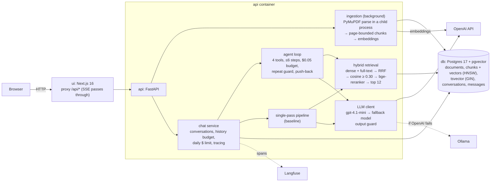

# Agentic RAG over annual reports

A chatbot that answers questions about company annual reports (PDF). Every
claim cites the PDF file name and its 1-based page, and if the reports don't
contain the answer, the bot says so. You can open the passage behind any
citation.

The answer comes from an **agent**. The model writes its own search queries,
reads what comes back, searches again or reads a whole page if something is
missing, and then answers. A single-pass pipeline (one retrieval, one LLM call)
runs alongside it as the baseline, selectable in the UI.

- **Corpus:** the 14 reports in [starter/data/pdfs/](starter/data/pdfs/). They
  are ingested on first start, and more can be uploaded.
- **Task:** [FINAL_PROJECT.md](FINAL_PROJECT.md).
- **Eval log:** [EVAL.md](EVAL.md).

## Run it from a fresh clone

You need Docker and an OpenAI API key.

```bash
git clone https://github.com/Ziko-108/agentic-rag.git && cd agentic-rag
cp .env.example .env          # set OPENAI_API_KEY and POSTGRES_PASSWORD
docker compose up --build
```

- **UI:** http://localhost:3000
- **API:** http://localhost:8000. Interactive docs are at
  http://localhost:8000/docs, and `GET /health` is the health check.
- **First start:** the API ingests the 14 starter PDFs in the background, which
  took 4.5 minutes in the clean-clone test. Each document shows *pending →
  processing → ready* in the sidebar, and you can ask questions about the
  ready ones meanwhile.
- **Data:** it lives on the `pgdata` volume, so it survives `docker compose
  down`. To start from scratch, run `docker compose down -v`.
- **Ports:** if 5432, 8000 or 3000 is taken, set `DB_PORT`, `API_PORT` or
  `UI_PORT` in `.env`.

**NVIDIA GPU (optional).** The default image uses CPU PyTorch for the reranker,
at about 7–9 s per question. With an NVIDIA GPU and the container toolkit:

```bash
docker compose -f docker-compose.yml -f docker-compose.gpu.yml up --build
```

This brings it to about 2.5 s per question on an RTX 4060 Laptop.

**Optional `.env` settings:**
- `LANGFUSE_PUBLIC_KEY` / `LANGFUSE_SECRET_KEY` turn on tracing (see "Tracing").
- `FALLBACK_MODEL` and `OLLAMA_URL` set the local model used when OpenAI fails.
- `DAILY_USD_PER_USER` sets the per-user daily limit. The default is $1.

**Clean-clone test:** `python scripts/clean_clone.py --repo https://github.com/Ziko-108/agentic-rag.git`.
- It clones into a temporary folder and copies only `.env`.
- It starts the stack under another project name and other ports, waits until
  every PDF is ready, and asks a question through the UI's proxy.
- It checks for a citation, then tears everything down.
- Last result: **passed**, 14 PDFs ingested in 270 s, and the answer cited
  *RWE AG.pdf* p.47.

**Tests** (in `backend/`, with Postgres running, for example `docker compose up -d db`):

```bash
pip install torch==2.11.0 --index-url https://download.pytorch.org/whl/cpu
pip install -r requirements.txt -r requirements-dev.txt
pytest                       # 45 tests: unit + integration + tracing
```

## Architecture



There are three containers: `db`, `api` and `ui`.
- **Secrets** come from `.env`, which is git-ignored. `.env` is excluded from
  both Docker build contexts, and no key is baked into an image.
- **Baked into the API image:** the reranker model and the tokenizer, so a
  start needs no downloads (`HF_HUB_OFFLINE=1`).
- **User:** the API runs as a non-root user.

| path | what |
|---|---|
| [backend/app/ingest/](backend/app/ingest/) | parser, chunker, ingestion pipeline |
| [backend/app/retrieval/](backend/app/retrieval/) | hybrid search, reranker, company detection |
| [backend/app/chat/](backend/app/chat/) | agent, single-pass pipeline, prompts and output guard, LLM client, conversation service |
| [backend/app/main.py](backend/app/main.py) | HTTP API |
| [backend/app/tracing.py](backend/app/tracing.py) | Langfuse spans (no-op without keys) |
| [backend/tests/](backend/tests/) | unit tests, `integration/` (real API + fake LLM), tracing test |
| [backend/scripts/](backend/scripts/) | `retrieval_eval.py`, `injection_eval.py`, `reindex.py` |
| [ui/](ui/) | Next.js app |
| [starter/runs/](starter/runs/) | committed scorecards |

## How it works

### Ingestion
- `POST /documents` accepts a PDF up to 50 MB and returns `202`. Other files
  get `415`, and a file name that already exists gets `409`.
- Processing runs in the background. `GET /documents/{id}` shows
  `pending | processing | ready | failed` and the error if it failed.
- **Parsing** uses PyMuPDF in a separate low-priority process, one document at
  a time. A crash in native code fails that document, not the API. What I
  found by looking at the reports:
  - Every page has a text layer, so OCR isn't needed.
  - PyMuPDF's reading order handles the two-column pages.
  - Plain text destroys tables (one cell per line), so tables come from
    `find_tables()`, and their area is cut out of the page text.
  - `use_layout=False`: the layout model segfaulted on one report, was about 7×
    slower and garbled numbers in borderless tables.
  - Repeated headers and footers are dropped.
  - Citations use the PDF page position, never the printed page number, which
    differs.
- **Chunking** is page-bounded, so every chunk has exactly one page to cite.
  - Paragraphs are packed up to 500 tokens, with a 60-token overlap.
  - A heading starts a new chunk.
  - Each table is its own chunk. A large table is split by rows, and each part
    repeats the header row, so a number never loses its column name.
  - Every chunk starts with `[Company | p.N | Section]`, so the embedding and
    the LLM both know where a bare "406.1" comes from.
  - The 14 reports give 5,768 chunks.
- **Delete:** `DELETE /documents/{id}` removes the document, its chunks, their
  vectors and their full-text index entries. They are all rows of the same
  Postgres tables (`ON DELETE CASCADE`), so nothing is left in a separate
  store.

### Storage
Postgres is the source of truth for documents, chunks, conversations and
messages. pgvector keeps the embeddings in the chunk rows (HNSW, cosine), and a
generated `tsvector` column with a GIN index serves the lexical search.
`python scripts/reindex.py` rebuilds both indexes from the stored chunk text,
and `--embed` also recomputes the embeddings. Neither re-parses a PDF; the
re-embed of all 5,768 chunks took 6.7 s.

### Retrieval
1. Dense search (`text-embedding-3-small`) and Postgres full-text search (an
   OR query) run with 40 candidates each.
2. The two lists are fused with RRF (k=60).
3. Candidates below cosine **0.30** are dropped, so a search can return nothing.
4. The best 30 are reranked by the cross-encoder **bge-reranker-base**, and the
   **top 12** are returned.
5. **Company filter from the question** (bonus): the company names in the
   question are matched against the uploaded file names, with legal suffixes
   dropped, and the search is restricted to those reports.

Every setting was measured, not guessed: see [EVAL.md §1](EVAL.md#1-retrieval-settings-no-llm).

### The agent
A hand-written tool-calling loop ([agent.py](backend/app/chat/agent.py)) with
four tools:
- `search_reports(query, companies?)`;
- `read_page(document, page)`;
- `list_documents()`;
- `calculator(expression)`, which uses a safe AST evaluator, not `eval`.

Tool errors go back to the model as results that say what to try next, for
example "No report matches companies ['…']. Use list_documents.". They never
fail the request.

**It always stops:**
- at most 6 tool steps;
- a $0.05 budget per question;
- a repeat guard: the same call with the same arguments is not run twice.

When a limit is hit, one last call without tools asks for an answer from what
was found.

**Push-back:** an answer without a citation after a single search is sent back
once to search with other words. See EVAL.md for why and what it cost.

### Grounded answers
- Sources are numbered `[S1]…[Sn]` across the whole agent run. The answer cites
  them, and the server maps each tag to `{document, page, section, chunk_id}`.
  Tags that point at no source are dropped.
- With no evidence, the answer is exactly `N/A — this is not available in the
  uploaded reports.`. The pipeline gives it without an LLM call when nothing
  passes the threshold.
- In the UI each tag is a numbered button, and clicking it opens the chunk
  (`GET /chunks/{id}`) in a side panel.

### API
| endpoint | |
|---|---|
| `POST /documents`, `GET /documents`, `GET /documents/{id}`, `DELETE /documents/{id}` | upload, list, status, delete |
| `POST /chat` | agent answer as JSON (what `eval.py` calls) |
| `POST /pipeline/chat` | single-pass baseline as JSON |
| `POST /chat/stream` | SSE: `step`, `token`, `reset`, `done` or `error` events; `mode` is `agent` or `pipeline` |
| `GET /conversations`, `GET /conversations/{id}`, `DELETE /conversations/{id}` | per user (`X-User-Id`) |
| `GET /chunks/{id}` | the passage behind a citation |
| `GET /health` | `{"status": "ok"}`, or 503 when the database is unreachable |

Errors carry a JSON `detail`:
- 404 for a missing or someone else's conversation;
- 409 for a duplicate upload;
- 413 and 415 for a bad upload;
- 422 for an invalid body;
- 429 for a spent daily budget;
- 503 when every model failed.

### Conversations, cost and safety
- **Conversations and messages** are stored in Postgres, so they survive a
  restart. Send `conversation_id` to continue one.
- **History:** follow-ups get the newest messages that fit in 2,000 tokens.
- **Cost:** every turn stores its prompt and completion tokens and its USD
  cost. Each `X-User-Id` has a daily limit ($1 by default); beyond it, requests
  get 429.
- **Fallback:** when the main model fails, the client retries with
  `FALLBACK_MODEL` through an OpenAI-compatible endpoint (Ollama). The
  integration test checks this: the fake main model returns 500, and the
  answer comes from the fallback.
- **Injection defence:**
  - sources are framed as untrusted data, with a reminder after every source
    block;
  - an output guard in code strips images and links and blocks answers that
    echo the system prompt.

  Results and limits are in [EVAL.md §4](EVAL.md#4-prompt-injection-test-set-bonus).

### UI (Next.js)
- Answers stream token by token, followed by a numbered source list.
- Each citation opens its passage in a side panel.
- A collapsible "Steps" list shows each search the agent ran (query and
  companies), with its result count and the number of steps.
- Uploads show a progress bar and then the ingestion status.
- The sidebar lists past conversations and the documents, each with a delete
  button.
- A switch selects the agent or the single-pass mode.
- Clear messages for a refusal ("Not found in the reports"), a spent budget, an
  API that is down (with a status dot in the header), and an interrupted
  answer.
- Each answer shows its cost and tokens and links to its Langfuse trace.

### Tracing
With Langfuse keys in `.env`, each chat turn becomes one trace:

```
chat-turn (agent)             user.id, session.id = conversation, tags = [mode]
├── llm (generation)          model, messages, tokens in/out, USD cost
├── search_reports (tool)     arguments, result
│   └── retrieval (retriever) query, dense/lexical/fused/above-threshold counts, top scores
└── llm (generation)          final answer
```

This tree is from a real trace in Langfuse Cloud.
- **Question:** "Who is the CEO of Datalogic?"
- **LLM calls:** 569 + 21 tokens ($0.000261), then 1,007 + 13 tokens
  ($0.000424).
- **Total:** $0.000685, which matches what the API recorded for the turn.

Spans are linked to their parent explicitly, because the agent generator's
steps run in different threads under the streaming response. Tracing errors
never fail a request, and without keys tracing is a no-op.

### Tests
There are 45 tests, and `pytest` runs them all.
- **Unit tests** cover the parts whose output depends only on their input:
  - parser helpers: body font, headings, running headers and footers, table
    cleanup;
  - the chunker: page bounds, packing and overlap, table splitting with
    repeated headers;
  - company detection;
  - citations and the output guard;
  - the calculator;
  - the agent loop with a scripted fake model: step cap, repeat guard, tool
    errors, push-back.
- **Integration test** ([tests/integration/test_api.py](backend/tests/integration/test_api.py)):
  - The real API runs as a uvicorn subprocess against the real Postgres, with
    a fake OpenAI-compatible server (chat and embeddings), so no request
    leaves the machine.
  - It uploads a generated PDF and waits until it is ready.
  - It checks that the agent cites the right page and that the passage opens.
  - It checks follow-ups, per-user isolation, pipeline refusal, SSE events,
    fallback, the 503 when every model is down, and delete.
- **Tracing test:** it checks the span tree with an in-memory exporter, with
  each generator step in its own thread.

## Results

The golden set has 16 questions, scored by the unchanged `eval.py`. The
scorecards are in [starter/runs/](starter/runs/), and the full log with hand
checks is in [EVAL.md](EVAL.md).

| | accuracy | refusals | evidence cited | s / question | $ / 16 questions |
|---|---|---|---|---|---|
| single-pass (pipeline-v4) | **0.846** | 1.0 | **0.500** | **4.3** | **0.033** |
| agent (agent-v4) | 0.769 | 1.0 | 0.417 | 7.0 | 0.136 |

**Is the agent worth it?** On this set, no:
- It gets the same quality, within the measured noise of one question, for 4×
  the cost and 1.6× the time.
- The questions mostly need one good search, and the pipeline's search is
  already strong: hybrid, company filter and reranker.
- gpt-4.1-mini rarely searches twice unless the loop makes it.

The agent's real wins are questions whose first search misses: q03 and q04
found their page only on the second search. See [EVAL.md §3](EVAL.md#3-agent-vs-single-pass-pipeline).

**Eval-driven changes,** each measured before and after:
1. The threshold moved from the reranker score to cosine 0.30.
2. The agent got the push-back on uncited answers: evidence 0.417 → 0.583, for
   2.4× the cost.
3. Prompt-injection defences were added, with no regression on the golden set.

Dropped changes: the MiniLM reranker, the reranker-score threshold, and prompt
examples taken from golden questions (overfitting).

**Bonus work** and its evidence:
- **Real web frontend** (Next.js + React + TypeScript): [ui/](ui/).
- **Metadata filter from the question** (company): retrieval recall@12 goes
  from 0.750 to 0.833 with the filter, and to 0.917 with the reranker on top;
  search time falls from 5.1 s to 1.1 s ([EVAL.md §1](EVAL.md#1-retrieval-settings-no-llm)).
- **Prompt-injection test set:** 13 attacks (4 held out) in both modes, with
  results before and after the defences ([EVAL.md §4](EVAL.md#4-prompt-injection-test-set-bonus),
  [starter/runs/injection-v1.json](starter/runs/injection-v1.json),
  [injection-v2.json](starter/runs/injection-v2.json)).

## Decisions and trade-offs

| decision | why | cost |
|---|---|---|
| **Postgres + pgvector** instead of Qdrant | One database for documents, chunks, vectors, full-text, conversations and messages. Delete is a single cascade, the vector index rebuilds from the table, and there is one container fewer. | Vector search scales less far than in a dedicated engine. That is irrelevant at 6k chunks. |
| **Postgres full-text** as the "lexical" half | It is already in the database and indexed (GIN). | It is not BM25, it has no IDF tuning, and it is weak on its own (recall@12 0.25). It only helps in fusion. |
| **Hand-written agent loop** instead of LangGraph | It is about 100 lines I can explain line by line. Limits, the repeat guard, push-back, streaming and tracing are plain code. | No graph tooling or checkpointing. |
| **gpt-4.1-mini** | Cheap and fast, with a full eval run at $0.03–0.15. | A weak planner that ignores "search again" and obeys some planted instructions. A stronger model would be the next experiment. |
| **bge-reranker-base, local** | The best recall in the measurements, and no API cost. | A 1.1 GB model in the image. On CPU it is the slowest step, limited to 4 threads so it doesn't take over the machine. A GPU override is available. |
| **Threshold on cosine, not on the reranker score** | Cosine scores separate on-topic from off-topic on this corpus, and reranker scores don't. | It depends on the embedding model and must be re-measured if that changes. |
| **Page-bounded chunks with a header line** | Every chunk has exactly one page to cite, and bare numbers keep their company and section. | A paragraph that runs across a page break is split. |
| **`find_tables(use_layout=False)`** | Stable and fast, and numbers stay intact. | Borderless tables stay as plain text. |
| **Next.js + a proxy route** instead of Streamlit | A real frontend: SSE, a citation panel, upload progress. The proxy means no CORS, and the browser never sees the API's address. | A third container and a Node build. |
| **Models baked into the image** | Offline start, and no 1 GB download on first request. | A larger image: about 2.9 GB on disk with CPU torch. |
| **FastAPI background tasks + a child process** for ingestion | Simple, and a parser crash can't kill the API. | No queue. An API restart during ingestion marks the document as failed, and you upload it again. |

## What doesn't work (known limitations)

- **The agent is not better than the pipeline** on the golden set, just
  dearer. It often answers without `[S#]` tags; in agent-v4, q07 had the right
  answer but no citation. After a push-back, some answers mix facts with a
  final "N/A".
- **Wrong or missed answers** in the latest runs:
  - **q08:** leadership changes at Origin Bancorp. It is missed in both modes.
  - **q11:** HCA dividend policy. The agent says "Yes", but the expected answer
    is "No".
  - **q13:** Seiko Epson dividend. It flips between runs.
  - **q04 and q07:** wrong in the pipeline.
- **Prompt injection is only partly defended.** The output guard reliably stops
  image/link exfiltration and system-prompt echoes. But a planted instruction
  can still change the answer itself: a canary, a wrong figure, the language.
  In one injection run, the agent also mixed up companies (it named another
  company's plant).
- **The scorer is a string matcher,** so some "correct" answers are wrong and
  some wrong ones are right. EVAL.md lists the ones I checked by hand.
- **The Ollama fallback was tested only with a fake model** (integration test).
  It is not demonstrated with a real local model, because Ollama wasn't
  installed on the dev machine. Set `FALLBACK_MODEL=qwen2.5:7b` and
  `OLLAMA_URL=http://host.docker.internal:11434/v1` to use it.
- **No OCR.** These reports all have text layers. Charts and figures are not
  read, and scanned PDFs would produce no chunks.
- **No migrations.** Tables are created at startup with `create_all`, so a
  schema change needs `docker compose down -v`.
- **No real authentication.** `X-User-Id` is trusted as sent, so anyone can
  claim any id, and the daily budget is per claimed id.
- **Ingestion has no queue.** Documents parse one at a time inside the API
  container. Restarting the API during ingestion marks that document as
  failed.
- **Golden set size:** 16 questions means one question is about 8 points of
  accuracy. Small differences between runs are noise.

## AI-assisted development

The code was written with Claude Code. I made the main decisions:
- the stack and the number-backed settings;
- what to keep or drop after each eval;
- not tuning prompts to the golden questions.

Each design choice above can be traced to a measurement or a failure I looked
at.
